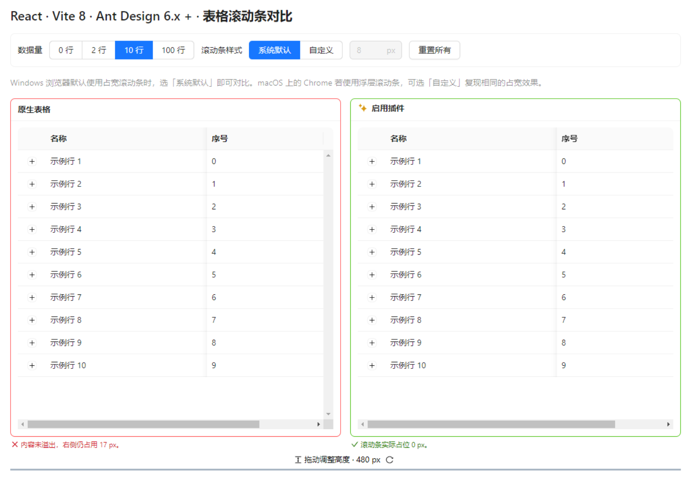

# unplugin-antd-table-better-scrollbar

让 Ant Design Vue 和 Ant Design（React）的固定表头表格按需显示原生纵向滚动条，并让表头始终为它留出实际占用的宽度。插件在构建时接入，业务代码继续使用原生 `<a-table>` 或 `<Table />`。

## 解决什么问题

给表格设置 `scroll.y` 后，即使只有两行数据，右侧也可能留下一条灰色空槽。这个现象在 Windows 等使用占宽滚动条的环境里尤其明显。单独给表体加 `overflow-y: auto` 可以收起空槽，但固定表头是另一张表，它可能仍然保留一个滚动条宽度，导致最后一列上下错位。

插件监听表体和内容的尺寸，用表体实际占用的滚动条宽度同步表头。内容放得下时占位为 0；新增数据、展开一行或拖小表格高度后，如果滚动条出现，表头就为它让出相同宽度。使用系统滚动条和自定义宽度时都按实际值计算。

### Windows 系统默认滚动条下的实测对比

以下两张截图均来自 Windows，示例中的滚动条样式均为「系统默认」。**Ant Design Vue 和 Ant Design（React）都出现了相同的纵向滚动条空槽。** 两个示例都设为 10 行数据、表体高度 480 px，内容在纵向上放得下。每张图左侧的原生表格仍为纵向滚动条预留了 17 px，右侧启用插件后，纵向占位均为 0 px。

**Ant Design Vue 4.x**


**Ant Design 6.x（React）**



### Ant Design Vue 的历史问题

AntDV 3.2.20 和 4.2.6 的 `vc-table` 在固定表头时都会给表体设置 `overflow-y: scroll`。在占宽滚动条环境下，即使只有两行数据，浏览器也会留出滚动条槽。以下版本号对应各自原帖，插件的适用版本见下方「安装与使用」。[3.2.20 源码](https://github.com/vueComponent/ant-design-vue/blob/3.2.20/components/vc-table/Table.tsx#L383) · [4.2.6 源码](https://github.com/vueComponent/ant-design-vue/blob/4.2.6/components/vc-table/Table.tsx#L382)

| 场景                         | 上游记录                                                                                                                                                                                                                                                                                                                                                                               |
| ---------------------------- | -------------------------------------------------------------------------------------------------------------------------------------------------------------------------------------------------------------------------------------------------------------------------------------------------------------------------------------------------------------------------------------- |
| 短表也出现滚动条槽           | 1.4.10 用户在 Windows 上设置 `scroll.y` 后，内容不足 400 px 仍有占位。2.1.3 和 2.2.3 也有类似报告，其中 2.2.3 的复现只设置了纵向高度。[#1697](https://github.com/vueComponent/ant-design-vue/issues/1697) · [#4044](https://github.com/vueComponent/ant-design-vue/issues/4044) · [#4484](https://github.com/vueComponent/ant-design-vue/issues/4484)                                  |
| 手动隐藏后，表头与固定列错位 | 早期用户就发现，强行隐藏表头滚动条后，横向滚到最右端会差一个滚动条宽度。**3.2.20** 的复现更接近今天的问题：表体改为 `overflow-y: auto` 后，表头仍有占位单元格。[#1499](https://github.com/vueComponent/ant-design-vue/issues/1499) · [#7190 及复现](https://github.com/vueComponent/ant-design-vue/issues/7190#issuecomment-1857442870)                                                |
| 自定义滚动条宽度             | 1.7.x 用户在 Chrome 中修改滚动条样式后观察到列宽不一致；**3.2.20** 用户进一步给出了「全局滚动条样式 + 内容高度小于 `scroll.y`」时，末列表头仍多出占位的复现。[1.7.8 讨论](https://github.com/vueComponent/ant-design-vue/discussions/7324) · [#7410](https://github.com/vueComponent/ant-design-vue/issues/7410) · [#7687](https://github.com/vueComponent/ant-design-vue/issues/7687) |
| 4.x 的短表复现               | **4.2.6** 在 Windows 11、Chrome 中仍有人报告灰色空槽。英文和中文帖子使用同一份 CodeSandbox，属于同一组复现。[#8443](https://github.com/vueComponent/ant-design-vue/issues/8443) · [#8484](https://github.com/vueComponent/ant-design-vue/issues/8484)                                                                                                                                  |

### Ant Design React 的历史问题

React 版最直接的记录来自 **antd 6.1.3**：五行数据放得下，改成 `overflow-y: auto` 后，右侧固定列的表头和内容却相差一个滚动条宽度。维护者 afc163 解释，保持列对齐正是上游没有默认改成 `auto` 的原因。讨论给出了完整代码，后续 issue 补上了占宽滚动条环境下的截图和维护者答复。[讨论 #56465](https://github.com/ant-design/ant-design/discussions/56465) · [#56479 维护者回复](https://github.com/ant-design/ant-design/issues/56479#issuecomment-3710014471)

| 场景                               | 上游记录                                                                                                                                                                                                                                                                                                                                                                                                                                                                                                                  |
| ---------------------------------- | ------------------------------------------------------------------------------------------------------------------------------------------------------------------------------------------------------------------------------------------------------------------------------------------------------------------------------------------------------------------------------------------------------------------------------------------------------------------------------------------------------------------------- |
| 固定表头为什么预留宽度             | 早期固定表头实现尝试过用样式隐藏滚动条。维护者记录了各方案对列对齐、边框等样式的影响；另有 Windows 复现展示了隐藏后表头和表体的偏移。[#4637 方案回顾](https://github.com/ant-design/ant-design/issues/4637#issuecomment-280829518) · [#6800](https://github.com/ant-design/ant-design/issues/6800) · [#7017](https://github.com/ant-design/ant-design/issues/7017)                                                                                                                                                        |
| 从 2.x 到 5.x 的短表空槽           | 2.8.3 的复现把官方示例减到不足四行；3.2.2 在 Windows Firefox 上报告表体低于指定高度也有滚动条。4.x 的主帖里，上游贡献者进一步区分了空表与**已有数据但未溢出**的表格，并讨论了监听尺寸变化的成本。5.9.2 也有短表反馈。[#5639](https://github.com/ant-design/ant-design/issues/5639) · [#9483](https://github.com/ant-design/ant-design/issues/9483) · [#29082 贡献者回复](https://github.com/ant-design/ant-design/issues/29082#issuecomment-2186052918) · [#44993](https://github.com/ant-design/ant-design/issues/44993) |
| 表体改成 `auto` 后，操作列上下错位 | 在 5.15.1 和 5.13.0 的报告中，CSS 可以收起短表右侧的空槽，但操作列或右侧固定列仍与表头错位。4.24.7 的用户也记录过末端溢出的宽度恰好等于滚动条宽度，并提出按实际溢出情况计算占位。[#47777](https://github.com/ant-design/ant-design/issues/47777) · [#47996](https://github.com/ant-design/ant-design/issues/47996) · [#40498](https://github.com/ant-design/ant-design/issues/40498)                                                                                                                                      |
| 自定义滚动条宽度与动态 `scroll.y`  | 用户将滚动条设为 5 px 或 6 px 后，观察到表头和表体宽度不同。还有一份复现需要先渲染表格，再启用 `scroll.y`；维护者在该帖确认，这个具体复现已在 5.27.2 修复。[#22076 维护者回复](https://github.com/ant-design/ant-design/issues/22076#issuecomment-597082374) · [#32144](https://github.com/ant-design/ant-design/issues/32144) · [#54000 修复说明](https://github.com/ant-design/ant-design/issues/54000#issuecomment-3244160279)                                                                                         |

同类短表报告还包括 Windows Chrome 上的高度复现、macOS Edge 上的纵向空槽，以及只有一行数据的固定列场景。最后一例由维护者归入 #29082。[#20188](https://github.com/ant-design/ant-design/issues/20188) · [#29392](https://github.com/ant-design/ant-design/issues/29392) · [#32065](https://github.com/ant-design/ant-design/issues/32065) · [#32764](https://github.com/ant-design/ant-design/issues/32764) · [#37910 维护者回复](https://github.com/ant-design/ant-design/issues/37910#issuecomment-1272751839)

另有用户以 `y: "max-content"` 复现右侧出现不可滚动的槽，也有人提出让滚动条只在内容超过阈值时出现的功能请求。[#25749](https://github.com/ant-design/ant-design/issues/25749) · [#25362](https://github.com/ant-design/ant-design/issues/25362)

**React 还处理表头末尾多出的一条竖线。** 纵向滚动条出现时，最后一个数据列表头的右边会多出占位单元格。Ant Design 的列间分隔线因而也画在这两者之间。插件只隐藏这里的装饰线，保留正常列之间的分隔线和滚动条占宽。#56713 的主帖讨论空表切换数据时的列宽跳动；其中一条评论另外记录了这条多余的分隔线。[#56713 中关于分隔线的原始反馈](https://github.com/ant-design/ant-design/issues/56713#issuecomment-3815411230)

## 安装与使用

首个 npm 版本发布后，在使用表格的项目中将插件添加为开发依赖：

```sh
pnpm add -D unplugin-antd-table-better-scrollbar
```

**Vue + Vite** 在现有 `vite.config.ts` 中注册 Vue 入口：

```ts
import { defineConfig } from 'vite';
import vue from '@vitejs/plugin-vue';
import { AntdTableBetterScrollbar } from 'unplugin-antd-table-better-scrollbar/vite';

export default defineConfig({ plugins: [vue(), AntdTableBetterScrollbar()] });
```

**React + Vite** 使用 `/react/vite` 入口：

```ts
import { defineConfig } from 'vite';
import react from '@vitejs/plugin-react';
import { AntdTableBetterScrollbar } from 'unplugin-antd-table-better-scrollbar/react/vite';

export default defineConfig({ plugins: [react(), AntdTableBetterScrollbar()] });
```

其他构建工具使用相同的 `AntdTableBetterScrollbar()`。下表是接在包名之后的入口路径。

| 构建工具              | Vue 入口   | React 入口       | 注册位置                                                      |
| --------------------- | ---------- | ---------------- | ------------------------------------------------------------- |
| Vite 7 / 8            | `/vite`    | `/react/vite`    | `plugins`                                                     |
| Rspack / Rsbuild      | `/rspack`  | `/react/rspack`  | Rspack 的 `plugins` 或 Rsbuild 的 `tools.rspack.plugins`      |
| Webpack 5 / Vue CLI 5 | `/webpack` | `/react/webpack` | Webpack 的 `plugins` 或 Vue CLI 的 `configureWebpack.plugins` |

Vue 也支持显式的 `/vue/vite`、`/vue/rspack`、`/vue/webpack`。React 入口会自动引入分隔线样式，Webpack 项目需要能加载 CSS。接入后照常设置 `scroll.y`，无需添加表格属性或包装组件。

| 组件库           | 适用范围与验证版本                                                                                                                                |
| ---------------- | ------------------------------------------------------------------------------------------------------------------------------------------------- |
| Ant Design Vue   | 面向 3.2.20 和从 4.0.0 起的 4.x 正式版。回归覆盖 3.2.20、4.0.0、4.2.6；其中 4.0.0 搭配 Vue 3.3.13 验证。                                          |
| Ant Design React | 普通固定表头表格。已验证 React / React DOM 19.3.1、Ant Design 6.7.1 和 `@rc-component/table` 1.12.0。虚拟表格和函数形式的自定义表体沿用上游行为。 |

插件匹配组件库的 ESM 表格实现。遇到目标范围外的 AntDV 版本或未经验证的 React 底层表格版本时，会发出警告并继续尝试；核心滚动条补丁无法准确匹配时，构建会报错并指出对应文件。React 的分隔线修饰是可选的：如果表头代码无法唯一匹配，插件会静默跳过这项修饰；上游已移除分隔线时，样式也不会画出新的线。

## 参与开发与提交 PR

仓库使用 TypeScript、Vite+、Node.js 26.13.1 和 pnpm 12.21.0。Fork 仓库并克隆到本地后，在根目录运行：

```sh
pnpm install
pnpm exec playwright install chromium
pnpm exec vp run playground-vite8#dev        # Ant Design Vue
# 或
pnpm exec vp run playground-react-vite8#dev  # Ant Design React
```

示例左侧是原生表格，右侧启用插件。在默认高度下切换 **2 行 → 100 行 → 2 行**，可以观察滚动条占位是否出现并收回。展开一行、拖动高度或把自定义滚动条从 8 px 调到 48 px，可以验证表头在尺寸变化后是否仍然对齐。Windows 可选「系统默认」；使用浮层滚动条的环境可选「自定义」观察占宽效果。

Vue 示例默认使用 AntDV 4，可通过环境变量 `ANTDV_MAJOR=3` 切到 3.2.20。`pnpm dev` 会同时打开 8 个开发服务。

修改后在根目录运行：

```sh
pnpm exec vp check
pnpm exec vp test run
```

提交 PR 时，请写明组件库版本、操作系统、浏览器、滚动条样式和复现步骤。涉及布局的改动，请附上左右对照截图或表头与表体的占宽测量值，方便复核。

## 发布到 npm

向 main 推送代码或提交 PR 时，工作流通过 Vite+ 在 Linux 和 Windows 上运行检查、构建，并使用 runner 预装的 Chrome 执行浏览器回归测试。Linux 在运行测试时生成 LCOV 报告。两端测试通过后，覆盖率任务将这份报告上传至 Codecov。

发布前，更新根目录 `package.json` 的版本号。将改动合入 main 并确认测试通过后，推送对应的版本标签（例如 `v1.2.3`）。发布工作流先用 `changelogithub` 按 Conventional Commits 生成 GitHub Release 说明，再构建插件并发布到 npm。生成说明失败时仍会继续构建和发布。

在 npm Trusted Publisher 中选择本仓库，工作流文件名填写 `release.yml`，环境名称留空，并允许直接发布。

## License

[MIT](./LICENSE)

Copyright (c) 2026-present, [REFINIST](https://github.com/refinist)
