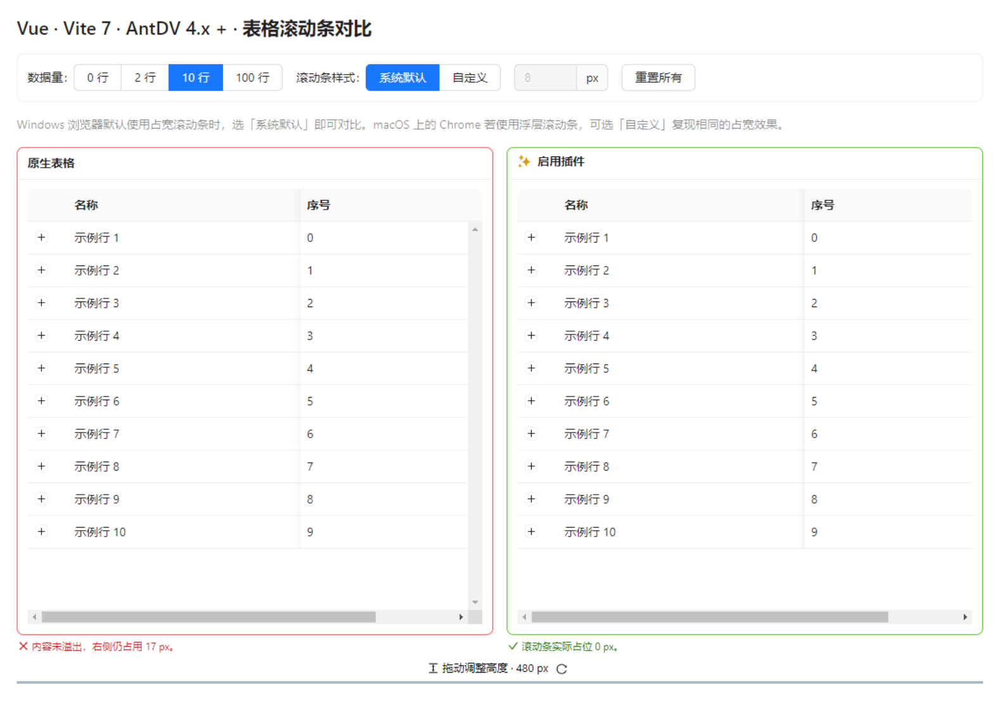

# unplugin-antd-table-better-scrollbar

[简体中文](./README.zh-CN.md) · **English**

[](https://www.npmjs.com/package/unplugin-antd-table-better-scrollbar)
[](https://app.codecov.io/gh/refinist/unplugin-antd-table-better-scrollbar/tree/main)

Show the native vertical scrollbar in fixed-header Ant Design Vue and Ant Design (React) tables only when the rows overflow. The plugin keeps the header aligned with the body by reserving exactly the width the scrollbar occupies. It runs at build time, so your application can keep using `<a-table>` or `<Table />` as usual.

## Installation and usage

Install the plugin as a development dependency in the project that uses the table.

```sh
pnpm add -D unplugin-antd-table-better-scrollbar
```

**Vue with Vite** — Register the Vue entry point in your existing `vite.config.ts`.

```ts
import { defineConfig } from 'vite';
import vue from '@vitejs/plugin-vue';
import { AntdTableBetterScrollbar } from 'unplugin-antd-table-better-scrollbar/vite';

export default defineConfig({ plugins: [vue(), AntdTableBetterScrollbar()] });
```

**React with Vite** — Use the `/react/vite` entry point.

```ts
import { defineConfig } from 'vite';
import react from '@vitejs/plugin-react';
import { AntdTableBetterScrollbar } from 'unplugin-antd-table-better-scrollbar/react/vite';

export default defineConfig({ plugins: [react(), AntdTableBetterScrollbar()] });
```

Other build tools use the same `AntdTableBetterScrollbar()` call. Append the appropriate entry point below to the package name.

| Build tool            | Vue entry point | React entry point | Where to register the plugin                                |
| --------------------- | --------------- | ----------------- | ----------------------------------------------------------- |
| Vite 7 / 8            | `/vite`         | `/react/vite`     | `plugins`                                                   |
| Rspack / Rsbuild      | `/rspack`       | `/react/rspack`   | Rspack’s `plugins` or Rsbuild’s `tools.rspack.plugins`      |
| Webpack 5 / Vue CLI 5 | `/webpack`      | `/react/webpack`  | Webpack’s `plugins` or Vue CLI’s `configureWebpack.plugins` |

Vue also supports the explicit entry points `/vue/vite`, `/vue/rspack`, and `/vue/webpack`. The React entry points import the header divider CSS automatically, so Webpack projects need a CSS loader configured. Once the plugin is registered, set `scroll.y` as usual. No extra table props or wrapper components are required.

| Component library  | Supported scope and tested versions                                                                                                                                                                             |
| ------------------ | --------------------------------------------------------------------------------------------------------------------------------------------------------------------------------------------------------------- |
| Ant Design Vue     | Targets 3.2.20 and stable 4.x releases starting with 4.0.0. Regression tests cover 3.2.20, 4.0.0, and 4.2.6. Version 4.0.0 is tested with Vue 3.3.13.                                                           |
| Ant Design (React) | Standard fixed-header tables. Tested with React and React DOM 19.3.1, Ant Design 6.7.1, and `@rc-component/table` 1.12.0. Virtual tables and function-based custom table bodies retain their upstream behavior. |

The plugin patches the component library’s ESM table implementation. It warns and attempts the patch when it encounters an Ant Design Vue version outside the target range or an unverified version of the underlying React table package. If it cannot match the code for the core scrollbar patch, the build fails and identifies the affected file. The React divider adjustment is optional. The plugin silently skips it if it cannot find a unique match in the header code. If upstream has already removed the divider, the stylesheet leaves it that way.

## Why the last column can fall out of alignment

Setting `scroll.y` can leave an empty gray scrollbar gutter on the right, even in a table with just two rows. This is especially visible on Windows and other systems where scrollbars take up layout space. Setting `overflow-y: auto` on the table body removes the empty gutter. The fixed header, however, is a separate table. If it still reserves space for a scrollbar, the last column heading shifts out of alignment with its cells.

The plugin observes the size of the table body and its contents. When all rows fit, the header reserves 0 px. When adding data, expanding a row, or reducing the table height makes the scrollbar appear, the header reserves the width it actually takes up. The same measurement works for system scrollbars and custom scrollbar widths.

### Comparison with default Windows scrollbars

Both screenshots show 10 rows in a 480 px table body on Windows, with the scrollbar style set to the system default. All rows fit vertically. In both Ant Design Vue and Ant Design for React, the unmodified table on the left reserves 17 px for a scrollbar. With the plugin enabled, the table on the right reserves 0 px.

**Ant Design Vue 4.x**



**Ant Design 6.x (React)**


### Upstream reports for Ant Design Vue

In Ant Design Vue 3.2.20 and 4.2.6, `vc-table` sets `overflow-y: scroll` on the body of a fixed-header table. On systems where scrollbars consume layout space, the browser reserves a gutter even for two rows. The versions below identify the original reports. See [Installation and usage](#installation-and-usage) for the versions the plugin targets. [3.2.20 source](https://github.com/vueComponent/ant-design-vue/blob/3.2.20/components/vc-table/Table.tsx#L383) · [4.2.6 source](https://github.com/vueComponent/ant-design-vue/blob/4.2.6/components/vc-table/Table.tsx#L382)

| Scenario                                                       | Upstream findings                                                                                                                                                                                                                                                                                                                                                                                                                                                                   |
| -------------------------------------------------------------- | ----------------------------------------------------------------------------------------------------------------------------------------------------------------------------------------------------------------------------------------------------------------------------------------------------------------------------------------------------------------------------------------------------------------------------------------------------------------------------------- |
| Empty gutter in short tables                                   | On Windows with 1.4.10, setting `scroll.y` left a gutter even when the content was shorter than 400 px. Similar reports cover 2.1.3 and 2.2.3. The 2.2.3 example set only the vertical scroll height. [#1697](https://github.com/vueComponent/ant-design-vue/issues/1697) · [#4044](https://github.com/vueComponent/ant-design-vue/issues/4044) · [#4484](https://github.com/vueComponent/ant-design-vue/issues/4484)                                                               |
| Misaligned header and fixed columns after hiding the scrollbar | An early report showed a one-scrollbar-width offset when scrolling all the way to the right after hiding the header scrollbar. In **3.2.20**, setting the body to `overflow-y: auto` still left a spacer cell in the header. [#1499](https://github.com/vueComponent/ant-design-vue/issues/1499) · [#7190 reproduction](https://github.com/vueComponent/ant-design-vue/issues/7190#issuecomment-1857442870)                                                                         |
| Custom scrollbar widths                                        | Users of 1.7.x reported inconsistent column widths after styling scrollbars in Chrome. A **3.2.20** reproduction showed extra space at the end of the header when global scrollbar styles were applied and the content was shorter than `scroll.y`. [1.7.8 discussion](https://github.com/vueComponent/ant-design-vue/discussions/7324) · [#7410](https://github.com/vueComponent/ant-design-vue/issues/7410) · [#7687](https://github.com/vueComponent/ant-design-vue/issues/7687) |
| Short tables in 4.x                                            | Users reproduced the gray gutter in **4.2.6** with Chrome on Windows 11. The English and Chinese reports use the same CodeSandbox example. [#8443](https://github.com/vueComponent/ant-design-vue/issues/8443) · [#8484](https://github.com/vueComponent/ant-design-vue/issues/8484)                                                                                                                                                                                                |

### Upstream reports for Ant Design (React)

A report for **antd 6.1.3** shows the alignment problem with only five rows. All five fit, but switching the body to `overflow-y: auto` shifted the right fixed column’s header by one scrollbar width. Maintainer afc163 explained that preserving column alignment was the reason for the existing overflow behavior. The discussion includes the code, and the follow-up issue includes a screenshot from a system where scrollbars consume layout space. [Discussion #56465](https://github.com/ant-design/ant-design/discussions/56465) · [Maintainer response on #56479](https://github.com/ant-design/ant-design/issues/56479#issuecomment-3710014471)

| Scenario                                                    | Upstream findings                                                                                                                                                                                                                                                                                                                                                                                                                                                                                                                                                                                                                                                                                                     |
| ----------------------------------------------------------- | --------------------------------------------------------------------------------------------------------------------------------------------------------------------------------------------------------------------------------------------------------------------------------------------------------------------------------------------------------------------------------------------------------------------------------------------------------------------------------------------------------------------------------------------------------------------------------------------------------------------------------------------------------------------------------------------------------------------- |
| Why the fixed header reserves space                         | Early implementations used CSS to hide the scrollbar. Maintainers documented the effects on column alignment and borders. Separate Windows reproductions showed the offset between header and body after hiding the scrollbar. [Design notes on #4637](https://github.com/ant-design/ant-design/issues/4637#issuecomment-280829518) · [#6800](https://github.com/ant-design/ant-design/issues/6800) · [#7017](https://github.com/ant-design/ant-design/issues/7017)                                                                                                                                                                                                                                                   |
| Empty gutters from 2.x through 5.x                          | A 2.8.3 reproduction reduced the official example to fewer than four rows. In 3.2.2, Firefox on Windows showed a scrollbar when the body was shorter than the configured height. In the 4.x discussion, a contributor distinguished empty tables from populated tables whose rows all fit and discussed the cost of observing size changes. A 5.9.2 report also showed the gutter in a short table. [#5639](https://github.com/ant-design/ant-design/issues/5639) · [#9483](https://github.com/ant-design/ant-design/issues/9483) · [Contributor response on #29082](https://github.com/ant-design/ant-design/issues/29082#issuecomment-2186052918) · [#44993](https://github.com/ant-design/ant-design/issues/44993) |
| Misaligned action column after switching the body to `auto` | In 5.15.1 and 5.13.0, CSS removed the empty gutter, but the action column or right fixed column still failed to line up with its header. A 4.24.7 report measured overflow equal to the scrollbar width and proposed sizing the spacer according to actual overflow. [#47777](https://github.com/ant-design/ant-design/issues/47777) · [#47996](https://github.com/ant-design/ant-design/issues/47996) · [#40498](https://github.com/ant-design/ant-design/issues/40498)                                                                                                                                                                                                                                              |
| Custom widths and dynamic `scroll.y`                        | Users reported different header and body widths with 5 px or 6 px scrollbars. A separate issue required rendering the table first and then enabling `scroll.y`. A maintainer confirmed that 5.27.2 fixed that specific reproduction. [Maintainer response on #22076](https://github.com/ant-design/ant-design/issues/22076#issuecomment-597082374) · [#32144](https://github.com/ant-design/ant-design/issues/32144) · [Fix details on #54000](https://github.com/ant-design/ant-design/issues/54000#issuecomment-3244160279)                                                                                                                                                                                         |

Other short-table reports cover a height-dependent reproduction in Chrome on Windows, an empty vertical gutter in Edge on macOS, and a fixed-column table containing a single row. A maintainer grouped the single-row case under #29082. [#20188](https://github.com/ant-design/ant-design/issues/20188) · [#29392](https://github.com/ant-design/ant-design/issues/29392) · [#32065](https://github.com/ant-design/ant-design/issues/32065) · [#32764](https://github.com/ant-design/ant-design/issues/32764) · [Maintainer response on #37910](https://github.com/ant-design/ant-design/issues/37910#issuecomment-1272751839)

One report reproduced a gutter with no scrollable content using `y: "max-content"`. Another requested that the scrollbar appear only when content exceeds a threshold. [#25749](https://github.com/ant-design/ant-design/issues/25749) · [#25362](https://github.com/ant-design/ant-design/issues/25362)

**On React, the plugin also removes an extra divider at the end of the header.** When the vertical scrollbar appears, Ant Design adds a spacer cell after the last data column and draws a column divider between the two. The plugin hides that decorative line while preserving the dividers between data columns and the space occupied by the scrollbar. Issue #56713 discusses column widths shifting when data is added to an empty table. A comment on that issue documents the extra divider. [Divider report on #56713](https://github.com/ant-design/ant-design/issues/56713#issuecomment-3815411230)

## Development and pull requests

The repository uses TypeScript, Vite+, Node.js 26.13.1, and pnpm 12.21.0. After forking and cloning the repository, run these commands from the project root.

```sh
pnpm install
pnpm exec playwright install chromium
pnpm exec vp run playground-vite8#dev        # Ant Design Vue
# or
pnpm exec vp run playground-react-vite8#dev  # Ant Design React
```

Each demo shows the unmodified table on the left and the plugin-enabled table on the right. At the default height, switch from **2 rows → 100 rows → 2 rows** to see the scrollbar gutter appear and disappear. Expand a row, drag the height control, or change the custom scrollbar width from 8 px to 48 px to check that the header stays aligned. On Windows, select **系统默认** (system default). On systems with overlay scrollbars, select **自定义** (custom) to try a scrollbar that takes up layout space.

The Vue demos use Ant Design Vue 4 by default. Set `ANTDV_MAJOR=3` to run them with 3.2.20. Running `pnpm dev` starts all eight development servers.

After making changes, run the checks from the project root.

```sh
pnpm exec vp check
pnpm exec vp test run
```

When opening a pull request, include the component library version, operating system, browser, scrollbar style, and steps to reproduce. For layout changes, include side-by-side screenshots or measurements of the scrollbar space in the header and body so reviewers can verify the alignment.

## License

[MIT](./LICENSE)

Copyright (c) 2026-present, [REFINIST](https://github.com/refinist)
